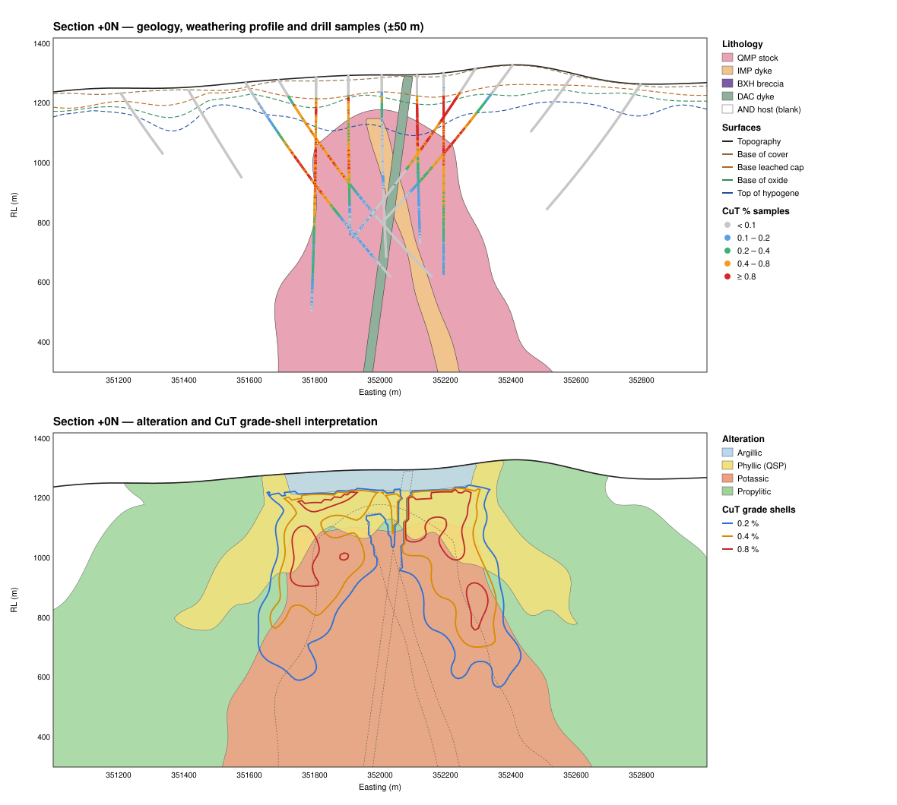
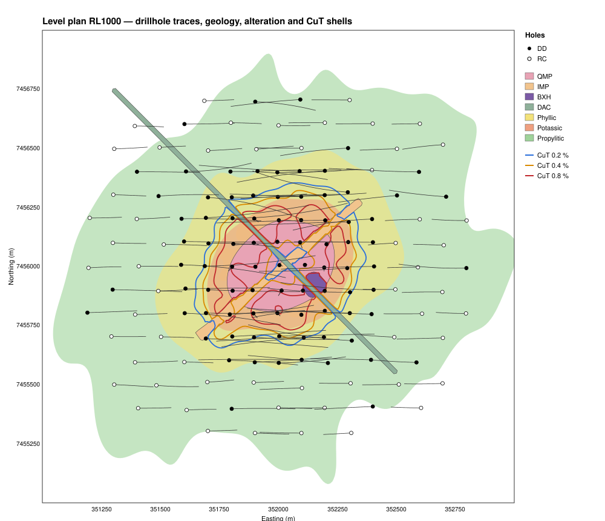

# Synthetic Porphyry Cu-Au-Mo Dataset for Wireframe Modelling

A complete, **synthetic** exploration dataset for a porphyry copper-gold-molybdenum
deposit. Use it to practise or teach the wireframing techniques resource geologists
use on porphyry systems, or to benchmark them:

| Technique | What it builds | Input files here |
|---|---|---|
| **Sectional (explicit) interpretation** | Polygons digitised on drill sections and level plans, then linked into solids with tie-lines | `drillholes/*`, `sections/*.str / *.dxf / interpretation_strings.csv` |
| **Implicit modelling** (RBF / Leapfrog-style) | Lithology and alteration volumes interpolated from drillhole contacts | `drillholes/lithology.csv`, `alteration.csv`, `contacts.csv` |
| **Weathering-profile DTMs** | Base of cover, base of leached cap, base of oxide, top of hypogene | `drillholes/weathering.csv`, `contacts.csv` (`CONTACT_TYPE = WEATHERING`) |
| **Grade-shell (indicator) wireframes** | CuT 0.2 / 0.4 / 0.8 %, Au 0.3 g/t, Mo 100 ppm envelopes | `drillholes/assay.csv`, `samples_desurveyed.csv` |
| **Estimation domains** | Lithology × alteration × mineral-zone domains for compositing and estimation | All of the above |

Every file comes from one analytical 3D geological model, so the **"true" wireframes**
(`data/wireframes/`) and their volumes and tonnages are known exactly. You can build
your own wireframes from the drilling alone and then check them against the truth.




---

## 1. The deposit model

| Feature | Description |
|---|---|
| Host rock | `AND`: andesite volcanics |
| Main intrusion | `QMP`: quartz-monzonite porphyry stock. Elliptical (long axis 060), cupola top at about RL 1180, widens and plunges gently NE with depth. Hosts the main mineralisation. |
| Inter-mineral dyke | `IMP`: porphyry dyke, strike 050 / dip 80 SE, rooted in the stock. Dilutes grade (about 0.45 × Cu). |
| Breccia pipe | `BXH`: hydrothermal breccia pipe (RL 900–1230), about 1.6 × Cu and 1.8 × Au. |
| Post-mineral dyke | `DAC`: barren dacite dyke, strike 135 / dip 85 NE. Cuts everything below the cover. |
| Cover | `COL`: 2–20 m of transported gravels, thicker to the NW |
| Alteration | Potassic core → phyllic (QSP) sheath that overprints the upper part → propylitic halo. Argillic near surface over the system. |
| Hypogene grade | Cu-Au shell centred just outside the stock contact. Low-grade core at depth inside the stock. Mo halo deeper and further out than Cu. |
| Supergene profile | Leached cap (Cu depleted, Au residual) → oxide (acid-soluble Cu) → chalcocite enrichment blanket (top-loaded, up to about 2.7 × hypogene) → hypogene. The leached cap and blanket are thicker over the pyrite-rich phyllic zone. |

**Coordinates:** fictional projected grid. The stock centre is at E 352 000 / N 7 456 000.
The model area is E 351 000–353 000 and N 7 455 000–7 457 000, from RL 300 up to
topography (about 1 230–1 320 m). All distances are in metres.

---

## 2. Drillhole database (`data/drillholes/`)

There are 143 holes (86 diamond `PDD###` and 57 RC `PRC###`) totalling 70.5 km, drilled
2018–2024. The holes lie on E–W sections every 100 m (−700N to +700N), at 100 m spacing
in the core and with 200 m step-outs. Holes over the centre are vertical. Elsewhere,
holes dip −60° toward the stock within the section plane.

| File | Rows | Columns | Notes |
|---|---|---|---|
| `collar.csv` | 143 | HOLE_ID, EAST, NORTH, RL, DEPTH, AZIMUTH, DIP, HOLE_TYPE, YEAR, SECTION | RL snapped to topography |
| `survey.csv` | 2 563 | HOLE_ID, DEPTH, AZIMUTH, DIP | Gyro survey every 30 m. Holes lift and drift realistically. Dip is negative downward. |
| `assay.csv` | 35 295 | HOLE_ID, SAMPLE_ID, FROM, TO, RECOVERY_PCT, CuT_pct, CuAS_pct, CuCN_pct, Au_gpt, Mo_ppm, Ag_gpt, S_pct | 2 m samples. Includes sequential Cu: CuAS (acid-soluble, oxides) and CuCN (cyanide-soluble, chalcocite/covellite). Values below detection limit are reported at half the detection limit. |
| `lithology.csv` | 420 | HOLE_ID, FROM, TO, LITHO | Logged at 0.5 m resolution, minimum unit 1 m |
| `alteration.csv` | 493 | HOLE_ID, FROM, TO, ALTERATION, INTENSITY | INTENSITY: 0 none, 1 weak, 2 moderate, 3 strong |
| `weathering.csv` | 715 | HOLE_ID, FROM, TO, MIN_ZONE | COV / LCH / OXD / SUP / HYP |
| `density.csv` | 2 712 | HOLE_ID, DEPTH, SG, METHOD | Diamond holes only, about every 20 m. Porous zones use the wax-coated method. |
| `contacts.csv` | 849 | HOLE_ID, DEPTH, EAST, NORTH, RL, CONTACT_TYPE, SURFACE, UNIT_ABOVE, UNIT_BELOW | Desurveyed contact points: lithology contacts plus the weathering surfaces BOC, BOLC, BOX and TOH |
| `samples_desurveyed.csv` | 35 295 | Assay columns plus sample midpoint EAST, NORTH, RL and LITHO, ALTERATION, MIN_ZONE | Point data, ready for implicit modelling, indicators and statistics |

Built-in realism:
- The gravel cover in RC holes is **not sampled**, and about 0.4 % of other intervals have no assay (blank fields), giving 410 unassayed samples. Exclude these from estimation. Do not treat them as zero.
- Core recovery is lower in the leached and oxide zones.
- Sample-scale noise is lognormal: Au is the most erratic, then Mo, then Cu.
- `codes.csv` lists every code with its description.

---

## 3. Section and plan interpretation strings (`data/sections/`)

These are reference interpretations of the true model, digitised as strings the way a
geologist does before linking sections into solids.

- **E–W sections** at every drill section (−700N … +700N, 15 sections)
- **Level plans** every 100 m (RL 500 … RL 1200)

| Unit | Kind |
|---|---|
| TOPO, BOC, BOLC, BOX, TOH | Open strings (sections only) |
| QMP, IMP, BXH, DAC | Closed lithology outlines |
| POT, PHY, ARG, PRO | Closed alteration outlines |
| CU_0.2, CU_0.4, CU_0.8 | Closed CuT grade-shell outlines |

Formats:
- `interpretation_strings.csv`: STRING_ID, SECTION_OR_PLAN, VIEW, UNIT, CLOSED, SEQ, EAST, NORTH, RL
- `sections_EW.dxf`, `level_plans.dxf`: 3D polylines, one layer per unit and section (e.g. `QMP_P0N`, `CU_0p4_RL1000`)
- `*_geology.str`, `*_alteration.str`, `*_cu_gradeshells.str`: Surpac string files (Y, X, Z order). String numbers are listed in `codes.csv` (e.g. 10 = QMP, 31 = CuT 0.4 %).

---

## 4. Reference ("true") wireframes (`data/wireframes/`)

**Surfaces** (25 m triangulated DTMs, OBJ and DXF 3DFACE):
- topography
- base of cover (BOC)
- base of leached cap (BOLC)
- base of oxide (BOX)
- top of hypogene (TOH)

**Solids:** closed, manifold OBJ meshes with outward normals. Add `--dxf-solids` to also
write DXF.

| Solid | Triangles | Volume (Mm³) | True tonnes (Mt) | CuT % / Au g/t / Mo ppm |
|---|---:|---:|---:|---|
| litho_QMP_stock | 21 080 | 197.7 | | |
| litho_IMP_dyke | 23 344 | 20.0 | | |
| litho_BXH_breccia_pipe | 10 056 | 3.3 | | |
| litho_DAC_dyke | 46 008 | 32.9 | | |
| alt_POT_potassic | 35 318 | 416.3 | | |
| alt_PHY_phyllic | 48 648 | 232.5 | | |
| alt_ARG_argillic | 7 702 | 19.3 | | |
| alt_PRO_propylitic_outer | 29 978 | 3 120.8 | | |
| gradeshell_CuT_0.2pct | 45 514 | 217.8 | 564.5 | 0.531 / 0.213 / 138 |
| gradeshell_CuT_0.4pct | 35 312 | 115.4 | 302.2 | 0.747 / 0.294 / 129 |
| gradeshell_CuT_0.8pct | 20 870 | 37.1 | 101.6 | 1.108 / 0.408 / 107 |
| gradeshell_Au_0.3gpt | 23 060 | 46.9 | 125.9 | 0.944 / 0.412 / 93 |
| gradeshell_Mo_100ppm | 17 666 | 318.2 | 834.2 | 0.232 / 0.087 / 190 |

Notes on the table:
- All solids are clipped to topography and to the model box (RL 300 base, ±1 000 m in plan). The propylitic and Mo shells are therefore truncated by the box.
- True tonnes and grades are computed from the expected (noise-free) grade field on a 20 m point grid, using the zone- and lithology-dependent densities.
- The full table is in `wireframe_report.csv`.

---

## 5. Suggested workflows

1. **Load the database.** Import `collar`, `survey`, `assay`, `lithology`, `alteration`, `weathering` and `density` into Leapfrog Geo, Surpac, Datamine, Vulcan, Micromine, Deswik, GEOVIA or Python. They are standard from/to tables keyed on HOLE_ID.
2. **Weathering DTMs.** Grid or triangulate the `BOC`, `BOLC`, `BOX` and `TOH` contact points. Check that the surfaces never cross (each must lie at or below the one above it). Compare the result with `wireframes/surfaces/`.
3. **Sectional lithology model.**
   1. On each E–W section, digitise the QMP stock, IMP dyke, BXH pipe and DAC dyke, snapping to the logged contacts.
   2. Link the sections with tie-lines into solids.
   3. Cut the younger dykes out of the stock with booleans.
   4. Compare your strings with `sections/*_geology.str` and your volumes with section 4.
4. **Implicit model.**
   1. Use `contacts.csv` and `lithology.csv`.
   2. Use a chronology of `QMP` (early) → `BXH` / `IMP` (intra-mineral) → `DAC` (post-mineral, cuts all).
   3. Model the DAC and IMP dykes as veins, with structural trend 135/85 and 050/80.
5. **Alteration domains.** Model the potassic core, the phyllic overprint (above roughly RL 1080 in the core, deepening outward) and the propylitic halo. Interval selection by `INTENSITY` works well.
6. **Grade shells.**
   1. Composite `assay.csv` to 4–10 m within the mineral zones.
   2. Build indicator or RBF isosurfaces at CuT 0.2, 0.4 and 0.8 %.
   3. Split the shells by MIN_ZONE. The 0.8 % shell is dominated by the supergene blanket.
7. **Estimation domains.** Intersect the mineral zone (OXD / SUP / HYP) with the grade shells and lithology. Then check the contact behaviour, for example the hard boundary at the BOLC and the soft boundary at the stock contact.
8. **Validate.**
   1. Report the volume of each of your wireframes.
   2. Report tonnage and grade inside it, using `density.csv`.
   3. Compare with the true values in `wireframe_report.csv`.

---

## 6. Regenerating / variants

Requires Python 3.9+ and **numpy** (no other dependencies).

```bash
python3 generate.py                       # default seed 42 → ./data   (~1 min)
python3 generate.py --seed 7 --out data7  # a different deposit realisation
python3 generate.py --dxf-solids          # also write solids as DXF (large)
python3 preview.py --data data --out docs # redraw the SVG previews
python3 -m unittest discover -s tests -t .
```

| Path | Contents |
|---|---|
| `porphyry_gen/model.py` | The geological model: implicit fields for each unit, grade functions and supergene profile. Edit it to change the geometry or grades. |
| `porphyry_gen/drillholes.py` | Drill pattern, surveys, minimum-curvature desurvey and interval logging |
| `porphyry_gen/meshing.py` | Marching tetrahedra (watertight iso-surfaces) and marching squares (section strings) |
| `porphyry_gen/writers.py` | OBJ, DXF R12 and Surpac STR writers |

> **Disclaimer:** all data are synthetic and generated for training and software testing.
> They do not represent any real deposit.
